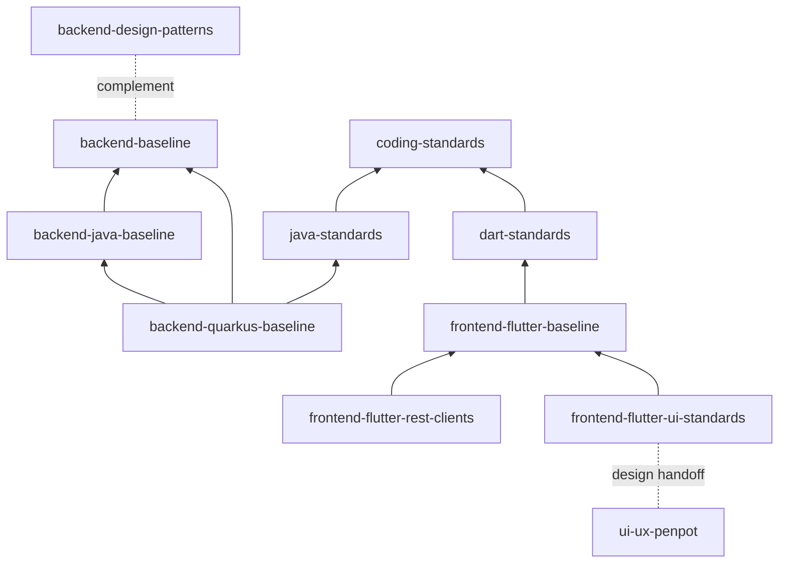

| Skill                                                                         | Summary                                                                                                                                            |
|-------------------------------------------------------------------------------|----------------------------------------------------------------------------------------------------------------------------------------------------|
| [backend-baseline](./backend-baseline/SKILL.md)                               | Define technology-agnostic backend architecture conventions, package organization, and error response standards.                                   |
| [backend-design-patterns](./backend-design-patterns/SKILL.md)                 | Provides technology-agnostic backend design patterns and implementation examples.                                                                  |
| [backend-java-baseline](./backend-java-baseline/SKILL.md)                     | Defines Java-specific implementations of the conventions and standards established by `backend-baseline`.                                          |
| [backend-quarkus-baseline](./backend-quarkus-baseline/SKILL.md)               | Defines Quarkus-specific configurations, conventions, and implementations based on `backend-baseline` and `backend-java-baseline`.                 |
| [coding-standards](./coding-standards/SKILL.md)                               | Defines general coding standards and best practices applicable across programming languages and technologies.                                      |
| [java-standards](./java-standards/SKILL.md)                                   | Defines Java-specific coding conventions, language features, and unit testing standards                                                            |
| [dart-standards](./dart-standards/SKILL.md)                                   | Defines Dart conventions, asynchronous code, typed data boundaries, exact money values, and unit testing.                                          |
| [frontend-flutter-baseline](./frontend-flutter-baseline/SKILL.md)             | Defines Flutter screaming architecture with service, mapper, repository, and presentation per subdomain, commons ownership, and state lifecycle.   |
| [frontend-flutter-rest-clients](./frontend-flutter-rest-clients/SKILL.md)     | Defines repository-based REST integration, generated OpenAPI clients, manual clients, common logging, failures, and session handling.              |
| [frontend-flutter-ui-standards](./frontend-flutter-ui-standards/SKILL.md)     | Defines theme tokens, component selection, responsive views, accessibility, forms, and localization.                                               |
| [ui-ux-penpot](./ui-ux-penpot/SKILL.md)                                       | Defines Penpot UI/UX flows, reusable design systems, accessibility, and visual validation through MCP.                                             |

# Hierarchy

